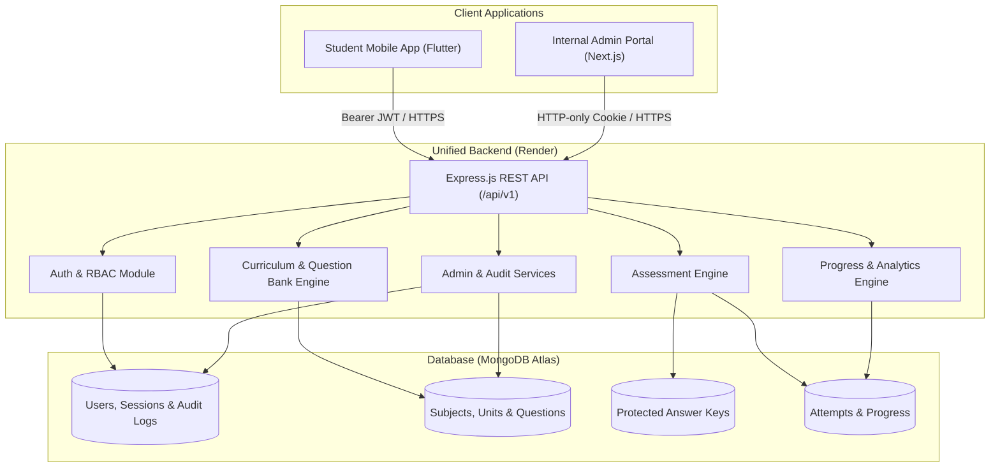

# ACEDEX — System Architecture Specification

## 1. Overview & Vision

**Acedex** is a cross-platform study management and assessment platform designed for Ethiopian students preparing systematically for the Ethiopian University Entrance Examination (EUEE).

Acedex focuses strictly on practice, assessment, habit formation, and performance diagnostics for Grades 9 through 12. It does not attempt to be a digital textbook or generic video LMS.

The system serves two dedicated client applications backed by a single unified backend:
- **Mobile Client (Student Platform):** Dedicated Android application built with **Flutter / Dart** for Grades 9–12 practice, assessments, results, and study habit tracking.
- **Web Client (Internal Admin Portal):** Administration and management platform built with **Next.js & TypeScript (App Router)** for managing curriculum, reviewing/importing/publishing 30-item question banks, inspecting student records, configuring assessment rules, and viewing platform analytics.
- **Unified Backend:** Modular monolith built with **Node.js, Express.js, TypeScript**, and **MongoDB Atlas** hosted on Render.



---

## 2. Monorepo Repository Structure

The repository is structured to maintain strict separation between application code, contracts, educational content, and documentation:

```text
Acedex/
├── apps/
│   ├── api/                     # Node.js + Express + TypeScript backend
│   │   ├── src/
│   │   │   ├── common/          # Shared errors, utils, and responses
│   │   │   ├── config/          # Environment & MongoDB connection management
│   │   │   ├── middleware/      # Logger, error handler, validator, security
│   │   │   ├── modules/         # Modular domain features (health, auth, etc.)
│   │   │   ├── routes/          # Aggregated /api/v1 router
│   │   │   ├── app.ts           # Express application setup
│   │   │   └── server.ts        # Server bootstrap & graceful shutdown
│   │   ├── tests/               # Vitest test suite
│   │   ├── package.json
│   │   ├── tsconfig.json
│   │   └── .env.example
│   │
│   ├── web/                     # Next.js App Router frontend (Phase 7)
│   │   └── .gitkeep
│   │
│   └── mobile/                  # Flutter Android application (Phase 7)
│       └── .gitkeep
│
├── packages/
│   └── contracts/               # Shared TypeScript schemas & DTOs (Zod)
│       ├── src/
│       ├── package.json
│       └── tsconfig.json
│
├── content/
│   └── question-bank/           # Questions strictly partitioned by Grade -> Subject -> Unit
│       ├── Grade-09/            # Biology, Chemistry, Economics, English, Geography, History, Math, Physics
│       ├── Grade-10/
│       ├── Grade-11/
│       ├── Grade-12/
│       └── README.md
│
├── docs/                        # Authoritative documentation
│   ├── plan.md                  # Master rebuild plan & requirements
│   ├── architecture.md          # Architecture & topology
│   ├── database.md              # MongoDB models, indexes, and relations
│   ├── authentication.md        # Google OAuth & session management
│   ├── api.md                   # REST API contract & specifications
│   └── development-roadmap.md   # Development phases & milestones
│
├── .gitignore
├── package.json                 # Root monorepo workspace configuration
└── README.md
```

---

## 3. Core Architectural Principles

### 3.1 Modular Monolith
The backend is structured as a modular monolith within `apps/api`. Modules are organized by feature domain (e.g. `auth`, `curriculum`, `assessments`, `progress`). Each module encapsulates its own routes, controllers, services, models, and validation schemas. Cross-cutting concerns (logging, error handling, security headers) live in `common/` and `middleware/`.

### 3.2 Single Application Backend
Express is the sole backend application server. Next.js is strictly a frontend client and does not serve as a second backend or database gateway.

### 3.3 Answer Security & Zero-Trust Scoring
Correct answer keys and explanations are **never exposed to student devices** before submission:
1. Public question APIs deliver only question IDs, question text, difficulty, and the 4 options (A, B, C, D).
2. Answer keys are stored in a protected internal collection or projection accessible only to the backend assessment evaluator.
3. Scores and explanations are computed server-side upon batch submission.

### 3.4 Resilient & Offline-Friendly
Network connectivity in target environments can be intermittent. Questions and user sessions can be cached locally on the client. Answer submissions are submitted in batches upon completion and protected by idempotency keys to prevent duplicate submission entries.

### 3.5 Cloud Production Readiness
- **Hosting:** Render (Web Service).
- **Database:** MongoDB Atlas (M0/M10 replica set with TLS).
- **Container / Node:** Node.js 22+ with strict environment validation, health check `/health`, and graceful shutdown hooks (`SIGINT`, `SIGTERM`).
