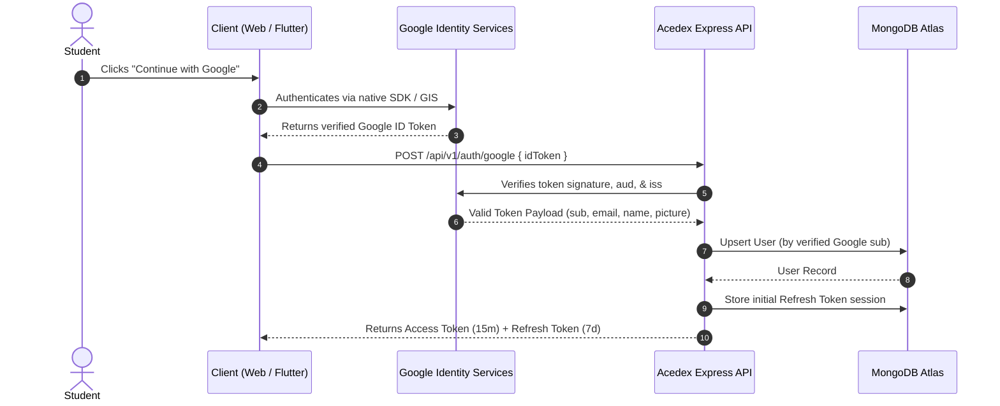

# ACEDEX — Authentication & Session Management

## 1. Overview

Acedex utilizes **Google OAuth 2.0 / OpenID Connect (OIDC)** as its primary authentication provider. Students log in directly with their existing Google accounts without requiring separate passwords or registration overhead.

Authentication is centralized in the Express backend, ensuring the same identity and progress state across both the **Flutter Android** app and the **Next.js Web** app.



---

## 2. Token Specification & Lifetimes

| Token | Type | Lifetime | Storage (Web) | Storage (Flutter) | Purpose |
|---|---|---|---|---|---|
| **Access Token** | JWT | 15 minutes | In-memory / Auth Header | In-memory / Secure Storage | Authorizes `/api/v1/*` requests via `Authorization: Bearer <token>` |
| **Refresh Token** | Cryptographic Token / JWT | 7 days | `HttpOnly`, `Secure`, `SameSite=Strict` Cookie | `flutter_secure_storage` (EncryptedSharedPreferences) | Rotated to obtain new access tokens |

### 2.1 Access Token Payload
```json
{
  "sub": "64f1a2b3c4d5e6f7a8b9c0d1",
  "email": "student@example.com",
  "displayName": "Abebe Bikila",
  "role": "student",
  "iat": 1731630000,
  "exp": 1731630900
}
```

---

## 3. Refresh Token Rotation & Family Tracking

To protect against token leakage and replay attacks, Acedex implements **Refresh Token Rotation with Reuse Detection**:

1. **Token Families:** When a student logs in, a new `familyId` is generated.
2. **Rotation:** Each call to `POST /api/v1/auth/refresh` invalidates the presented refresh token and issues a new refresh token under the same `familyId`.
3. **Reuse Detection:** If an already-invalidated or previous refresh token is presented, the system assumes theft or compromise, immediately revokes **all** refresh tokens belonging to that `familyId`, and requires the student to log in again.
4. **Storage:** In MongoDB, refresh tokens are stored hashed (SHA-256) so plain-text tokens are never at rest in the database.

---

## 4. Platform-Specific Implementation Details

### 4.1 Next.js Web Application
- Obtains Google ID Token via Google Identity Services (`@react-oauth/google` or official Google script).
- Transmits Google ID Token to `POST /api/v1/auth/google`.
- The Express backend writes the refresh token as an `HttpOnly`, `Secure`, `SameSite=Strict` (or `SameSite=Lax` for cross-site Render/Vercel domains) cookie named `acedex_rt`.
- The access token is returned in the JSON response body and retained in client memory.

### 4.2 Flutter Android Application
- Uses `google_sign_in` plugin to prompt the native Google account picker.
- Extracts `GoogleSignInAuthentication.idToken`.
- Transmits ID Token to `POST /api/v1/auth/google`.
- The Express backend detects a mobile client and returns both the access token and refresh token in the response JSON body.
- Flutter securely persists the refresh token using `flutter_secure_storage`.
- An automatic HTTP interceptor captures 401 responses and attempts a silent token refresh before failing.

---

## 5. Security Invariants

- **No Passwords Stored:** All password authentication is offloaded to Google.
- **Audience Verification:** Google ID tokens are strictly checked against `process.env.GOOGLE_CLIENT_ID`.
- **Zero Client Trust:** User attributes (`role`, `status`, `email`) are authoritative only from MongoDB; never accepted from untrusted client requests.
- **Session Revocation:** Logging out invalidates the active refresh token in MongoDB and clears client credentials.
