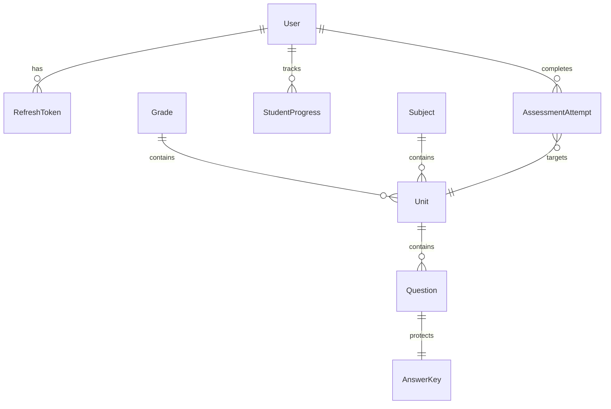

# ACEDEX — Database Design & Schema Specifications

## 1. Overview

Acedex utilizes **MongoDB Atlas** as its authoritative primary datastore. All database access is mediated strictly through the Node.js / Express backend using **Mongoose**.

Frontend clients (Flutter mobile, Next.js web) **never access the database directly**.



---

## 2. Core Collections & Schemas

### 2.1 `users` Collection
Stores student and staff accounts. Initially populated via Google OAuth 2.0 verification.

```typescript
{
  _id: ObjectId,
  googleId: String,           // Unique Google 'sub' identifier (indexed, unique)
  email: String,              // Normalized lower-case email (indexed, unique)
  displayName: String,        // Verified name from Google profile
  avatarUrl: String,          // Profile picture URL
  role: 'student' | 'content_manager' | 'admin' | 'super_admin', // Default: 'student'
  status: 'active' | 'suspended' | 'pending_deletion', // Default: 'active'
  lastLoginAt: ISODate,
  createdAt: ISODate,
  updatedAt: ISODate
}
```

**Indexes:**
- `{ googleId: 1 }` (unique, sparse: true)
- `{ email: 1 }` (unique)
- `{ role: 1 }`
- `{ createdAt: -1 }`

---

### 2.2 `refresh_tokens` Collection
Manages session security, token rotation, and invalidation for both web and mobile.

```typescript
{
  _id: ObjectId,
  userId: ObjectId,           // Reference to users._id
  tokenHash: String,          // SHA-256 hash of the issued refresh token (indexed, unique)
  familyId: String,           // UUID representing the token family (rotation chain)
  isRevoked: Boolean,         // Default: false (true when invalidated or rotation breached)
  expiresAt: ISODate,         // Token expiration timestamp
  createdAt: ISODate
}
```

**Indexes:**
- `{ tokenHash: 1 }` (unique)
- `{ userId: 1, familyId: 1 }`
- `{ expiresAt: 1 }` with **TTL index** (`expireAfterSeconds: 0`) to automatically purge expired sessions from MongoDB.

---

### 2.3 `subjects` and `units` Collections
Organizes the national curriculum hierarchy across Grades 9–12.

**`subjects`:**
```typescript
{
  _id: ObjectId,
  code: String,               // e.g. "PHY", "BIO", "CHE", "MAT", "ENG", "ECO"
  name: String,               // e.g. "Physics"
  slug: String,               // e.g. "physics" (indexed, unique)
  order: Number,              // Display order in curriculum lists
  createdAt: ISODate
}
```

**`units`:**
```typescript
{
  _id: ObjectId,
  grade: Number,              // 9, 10, 11, or 12
  subjectId: ObjectId,        // Reference to subjects._id
  unitNumber: Number,         // e.g. 1, 2, 3
  title: String,              // e.g. "Physics and Human Society"
  isPublished: Boolean,       // Default: false
  questionCount: Number,      // Expected: 30
  createdAt: ISODate,
  updatedAt: ISODate
}
```

**Indexes:**
- `{ grade: 1, subjectId: 1, unitNumber: 1 }` (unique compound index)
- `{ isPublished: 1 }`

---

### 2.4 `questions` Collection (Public Question Content)
Contains the question stem and the 4 answer choices. **Does not store correct answers or explanations.**

```typescript
{
  _id: ObjectId,
  unitId: ObjectId,           // Reference to units._id
  externalId: String,         // e.g. "PHY-G09-U01-Q001" (indexed, unique)
  type: 'multiple_choice',    // Currently multiple_choice
  difficulty: 'easy' | 'medium' | 'challenging',
  question: String,           // Question stem
  options: [
    { id: 'A', text: String },
    { id: 'B', text: String },
    { id: 'C', text: String },
    { id: 'D', text: String }
  ],
  sourceReference: String,    // e.g. "Page 2"
  isPublished: Boolean,       // Default: true
  createdAt: ISODate
}
```

**Indexes:**
- `{ externalId: 1 }` (unique)
- `{ unitId: 1, isPublished: 1 }`
- `{ difficulty: 1 }`

---

### 2.5 `answer_keys` Collection (Protected Server-Only)
Maintains the authoritative answers and explanations. Stored in a separate collection to eliminate any accidental leakage via public question projection.

```typescript
{
  _id: ObjectId,
  questionId: ObjectId,       // Reference to questions._id (indexed, unique)
  externalId: String,         // e.g. "PHY-G09-U01-Q001"
  correctOptionId: 'A' | 'B' | 'C' | 'D',
  explanation: String,        // Explanatory breakdown of the correct choice
  createdAt: ISODate
}
```

**Indexes:**
- `{ questionId: 1 }` (unique)
- `{ externalId: 1 }` (unique)

---

### 2.6 `assessment_attempts` Collection
Records student submissions and authoritative evaluations.

```typescript
{
  _id: ObjectId,
  userId: ObjectId,           // Reference to users._id
  unitId: ObjectId,           // Reference to units._id
  attemptId: String,          // Client-generated UUID for idempotency (unique)
  answers: [
    {
      questionId: ObjectId,
      externalId: String,
      selectedOptionId: String, // 'A' | 'B' | 'C' | 'D' | null
      isCorrect: Boolean
    }
  ],
  score: Number,              // Raw score (e.g. 26)
  totalQuestions: Number,     // Total items (30)
  percentage: Number,         // Calculated: (score / totalQuestions) * 100
  durationSeconds: Number,    // Time spent in seconds
  startedAt: ISODate,
  submittedAt: ISODate
}
```

**Indexes:**
- `{ attemptId: 1 }` (unique, ensures duplicate POST submissions are idempotent)
- `{ userId: 1, unitId: 1, submittedAt: -1 }`
- `{ userId: 1, submittedAt: -1 }`

---

### 2.7 `student_progress` Collection
Aggregated progress summary per student, maintained incrementally to ensure rapid dashboard loading without heavy aggregation pipelines on every request.

```typescript
{
  _id: ObjectId,
  userId: ObjectId,           // Reference to users._id (indexed, unique)
  summary: {
    totalAttempts: Number,
    totalQuestionsAnswered: Number,
    averagePercentage: Number
  },
  subjectProgress: [
    {
      subjectId: ObjectId,
      completedUnits: Number,
      totalUnits: Number,
      averagePercentage: Number
    }
  ],
  unitProgress: [
    {
      unitId: ObjectId,
      bestScore: Number,
      bestPercentage: Number,
      attemptsCount: Number,
      lastAttemptAt: ISODate
    }
  ],
  updatedAt: ISODate
}
```

**Indexes:**
- `{ userId: 1 }` (unique)
- `{ updatedAt: -1 }`

---

### 2.8 `audit_logs` Collection
Records security and administrative activities (logins, role changes, question bank imports, deletions).

```typescript
{
  _id: ObjectId,
  userId: ObjectId,           // Optional reference to users._id
  userEmail: String,
  action: String,             // e.g. "USER_LOGIN", "ROLE_UPDATED", "QUESTION_BANK_IMPORTED"
  resource: String,           // e.g. "auth", "users", "curriculum", "question_bank"
  resourceId: String,
  details: Object,            // Arbitrary metadata payload
  ipAddress: String,
  userAgent: String,
  timestamp: ISODate
}
```

**Indexes:**
- `{ action: 1, timestamp: -1 }`
- `{ userId: 1, timestamp: -1 }`
- `{ resource: 1, resourceId: 1 }`

---

## 3. Database Connection Configuration

- **Development/Test:** Auto-indexing enabled (`autoIndex: true`), short server selection timeout (`serverSelectionTimeoutMS: 5000`). If no MongoDB instance is reachable, the server gracefully logs a warning and operates in degraded status.
- **Production (Atlas):** Strict `autoIndex: false` (indexes created via migrations or initialization scripts), TLS connection pooling (`maxPoolSize: 10`), automatic reconnection with exponential backoff.
