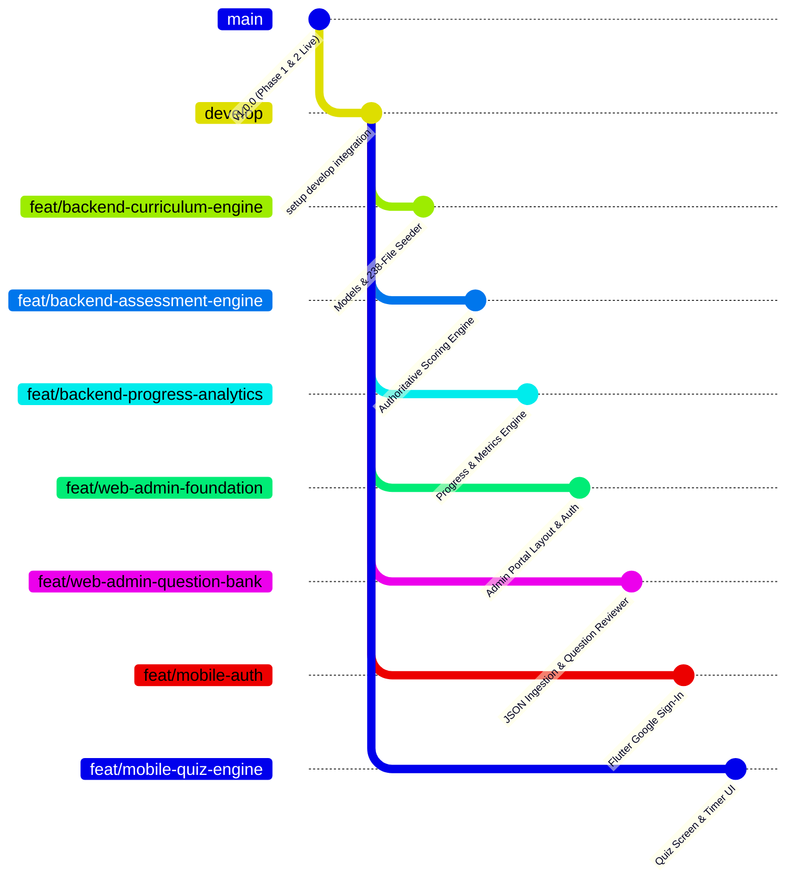

# ACEDEX — Master Git Branching & Team Strategy

This document outlines the complete branching hierarchy, team responsibilities, and release workflows across all engineering teams (Backend/API, Admin Web Portal, and Flutter Mobile).

---

## 1. Branch Topology Overview

---

## 2. Team Branch Directory

### 2.1 Core & Release Branches
| Branch | Base | Target | Owner | Description |
|---|---|---|---|---|
| **`main`** | — | — | DevOps / Lead | **Production release branch**. Deployed live on Render (`acedex-api.onrender.com`) and Vercel (`acedex.vercel.app`). Merges require 100% test green. |
| **`develop`** | `main` | `main` | Engineering Lead | **Integration branch**. All feature branches merge here for integration testing prior to release. |

---

### 2.2 Backend & API Team (`apps/api` & `packages/contracts`)
*Focus: Headless REST API, database schemas, question bank ingestion, assessment grading, analytics.*

| Branch | Base | Target | Description | Status |
|---|---|---|---|---|
| **`feat/backend-core`** | `develop` | `develop` | Umbrella branch for core backend engines & shared contracts. | **Active** |
| **`feat/backend-curriculum-engine`** | `develop` | `develop` | Mongoose models (`Subject`, `Unit`, `Question`, `AnswerKey`), 238-file JSON seeder, and curriculum query APIs. | **Next Up** |
| **`feat/backend-assessment-engine`** | `develop` | `develop` | Assessment submission endpoint (`POST /assessments/submit`), server-side scoring, and attempt history. | Planned |
| **`feat/backend-progress-analytics`** | `develop` | `develop` | Student progress aggregation, mastery calculation, and analytics endpoints. | Planned |
| **`feat/backend-admin-api`** | `develop` | `develop` | Administrative APIs for question bank management, unit publishing, student inspection, and audit logs. | Planned |

---

### 2.3 Web Admin Portal Team (`apps/web` — Next.js 14)
*Focus: Internal staff and admin management platform.*

| Branch | Base | Target | Description | Status |
|---|---|---|---|---|
| **`feat/web-admin-foundation`** | `develop` | `develop` | Next.js App Router admin layout, sidebar, Google sign-in with admin role verification, and session state. | Planned |
| **`feat/web-admin-question-bank`** | `develop` | `develop` | Question bank manager: JSON file uploader, previewer, 30-item validation visualizer, and publication toggles. | Planned |
| **`feat/web-admin-curriculum`** | `develop` | `develop` | Grade & Subject curriculum explorer, unit metadata editor, and curriculum statistics. | Planned |
| **`feat/web-admin-students`** | `develop` | `develop` | Student account search, detailed student attempt inspection, and account status management. | Planned |
| **`feat/web-admin-analytics`** | `develop` | `develop` | Platform dashboard: overall question bank metrics, student completion rates, and error rate analysis. | Planned |

---

### 2.4 Mobile App Team (`apps/mobile` — Flutter / Dart)
*Focus: Student-facing mobile learning and assessment application.*

| Branch | Base | Target | Description | Status |
|---|---|---|---|---|
| **`feat/mobile-foundation`** | `develop` | `develop` | State management (BLoC/Riverpod), API client (Dio/Http), and secure token storage (`flutter_secure_storage`). | Planned |
| **`feat/mobile-auth`** | `develop` | `develop` | Google Sign-In with Android Client ID, backend token exchange, and persistent auto-login splash. | Planned |
| **`feat/mobile-curriculum`** | `develop` | `develop` | Grades 9–12 selection, Subject cards, Unit list, and practice launch screen. | Planned |
| **`feat/mobile-quiz-engine`** | `develop` | `develop` | Unit assessment screen with per-question timer, 4-option selection, and batch submission flow. | Planned |
| **`feat/mobile-results-review`** | `develop` | `develop` | Assessment score breakdown, answer explanations review, and retry option. | Planned |
| **`feat/mobile-analytics-progress`** | `develop` | `develop` | Student dashboard: study streaks, subject mastery indicators, and performance tracking. | Planned |

---

### 2.5 DevOps & CI/CD
| Branch | Base | Target | Description | Status |
|---|---|---|---|---|
| **`chore/ci-cd-pipelines`** | `develop` | `develop` | GitHub Actions workflow for automated linting, type-checking, and Vitest runs on every pull request. | Planned |

---

## 3. Workflow & Merge Rules

1. **Isolation:** Each team works on its dedicated `feat/*` branch.
2. **Syncing:** Feature branches rebase or merge from `develop` regularly to stay up-to-date.
3. **Definition of Done for Merging into `develop`:**
   - [x] TypeScript compiles without errors.
   - [x] Automated tests pass (Vitest for API, Flutter test for Mobile).
   - [x] No credentials or secrets committed.
4. **Promotion to `main` (Production):**
   - Merges from `develop` into `main` trigger automated deployments on **Render** (API) and **Vercel** (Admin Portal).
