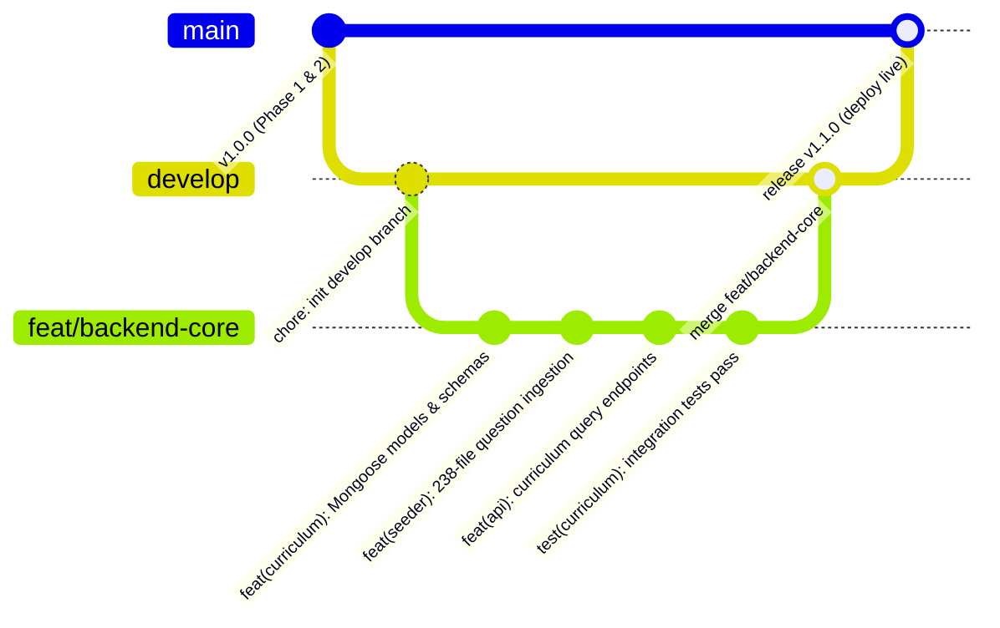

# ACEDEX — Engineering Working Principles & Git Branching Strategy

This document establishes the official development standards, branching strategy, quality gates, and architectural principles for the Acedex platform engineering team.

---

## 1. Core Engineering Principles

### 1.1 Backend-First Focus (Headless Platform)
- **Zero UI Distraction:** During the backend engineering phase, no frontend, mobile UI, or presentation code is written or modified. The API must be treated as a standalone headless product.
- **Contract-Driven Development:** All data shapes, request payloads, response envelopes, and query parameters are strictly defined first in `@acedex/contracts` using Zod schemas and exported TypeScript interfaces.
- **Self-Documenting & Testable:** Any backend capability must be testable via automated Vitest test suites and consumable by standard HTTP clients (Postman/Curl) before frontend integration starts.

### 1.2 Zero Client Trust & Security Isolation
- **Server-Side Authority:** The client is never trusted to calculate scores, grade assessments, validate timing, or dictate permissions.
- **Answer Key Physical Isolation:** Correct answers and pedagogical explanations reside in a separate MongoDB collection (`answer_keys`). Public question endpoints (`/api/v1/curriculum/units/:unitId/questions`) project **only** question stems, difficulties, and option choices (A, B, C, D) — never the answer key or explanation.
- **Strict Role-Based Access Control (RBAC):** Administrative endpoints (`/api/v1/admin/*`) require explicit `admin` or `super_admin` roles. Regular student tokens cannot access ingestion, publishing, or inspection endpoints.
- **Token Protection:** Refresh tokens are cryptographically hashed (SHA-256) before storage with MongoDB TTL expiry indexes, accompanied by token family tracking to immediately invalidate hijacked sessions upon replay detection.

### 1.3 Data Integrity & Ingestion Idempotency
- **Atomic & Idempotent Seeding:** All seeding scripts (such as ingesting the 238 question bank JSON files) must be idempotent. Re-running a seed command must safely update or skip existing records without creating duplicates.
- **Strict Validation at Ingestion:** Question bank JSON files must be verified against `QuestionBankFileSchema` before persistence (confirming exactly 30 questions per unit, valid difficulty, 4 choices, valid IDs).
- **Relational Integrity via Compound Indexes:** Unique compound indexes enforce database-level guarantees (e.g. `{ grade: 1, subjectCode: 1, unitNumber: 1 }` for units, `{ externalId: 1 }` for questions and answer keys).

### 1.4 Uniform API Envelopes
Every API route must respond with our standard envelope:
- **Success (`2xx`):**
  ```json
  {
    "success": true,
    "data": { ... },
    "meta": { "total": 100, "page": 1 }
  }
  ```
- **Error (`4xx`/`5xx`):**
  ```json
  {
    "success": false,
    "error": {
      "code": "VALIDATION_ERROR",
      "message": "Human-readable message",
      "details": [ ... ],
      "timestamp": "ISO-8601",
      "path": "/api/v1/..."
    }
  }
  ```

---

## 2. Git Branching Model & Release Strategy

We adhere to a structured Git flow tailored for cloud deployments on **Render** (API) and **Vercel** (Admin Portal):



### 2.1 Branch Hierarchy

| Branch | Purpose | Deployment Target | Protection Level |
|---|---|---|---|
| **`main`** | **Production:** Stable, fully verified release branch. | Render API (`acedex-api.onrender.com`), Vercel (`acedex.vercel.app`) | Protected. Merges only when 100% of tests pass. |
| **`develop`** | **Integration:** Next release development branch. | Staging / Local verification | Primary development target. |
| **`feat/<feature-name>`** | **Feature:** Scoped engineering milestone (e.g., `feat/backend-core`). | Local sandbox & Atlas test DB | Merged into `develop` via pull request or verified merge. |
| **`fix/<issue-name>`** | **Bugfix:** Targeted remediation of a specific bug. | Local verification | Merged into `develop` or `main`. |

### 2.2 Branch Naming Rules
- `feat/backend-core`: Core backend engines (Curriculum, Seeder, Assessment, Progress).
- `feat/<module-name>`: Specific module additions (e.g., `feat/assessment-engine`).
- `fix/<bug-description>`: Bug resolutions (e.g., `fix/token-rotation-expiry`).
- `chore/<task-description>`: Monorepo maintenance, config, dependencies.

### 2.3 Commit Message Convention (Conventional Commits)
All commit messages must follow the format:
`<type>(<scope>): <subject>`

**Allowed Types:**
- `feat`: New feature or endpoint.
- `fix`: Bug fix.
- `test`: Adding or modifying automated tests.
- `docs`: Documentation updates.
- `chore`: Build scripts, dependencies, configuration.
- `refactor`: Code change that neither fixes a bug nor adds a feature.

**Examples:**
- `feat(curriculum): implement Subject, Unit, Question, and AnswerKey models`
- `feat(seeder): add batch ingestion script for 238 question bank files`
- `test(curriculum): add integration tests for question delivery and answer key isolation`

---

## 3. Definition of Done (DoD) for Backend Modules

Before any feature branch is merged into `develop` or promoted to `main`:
1. **Compilation:** TypeScript builds with zero errors (`npm run build:api`).
2. **Contracts:** Request/response schemas defined and validated in `@acedex/contracts`.
3. **Automated Tests:** 100% of Vitest suites pass (`npm test`).
4. **Data Isolation:** Public endpoints verified to NEVER return answer keys or explanations.
5. **Idempotency:** Seeding/migration scripts tested for re-run safety.
6. **Documentation:** `docs/api.md`, `docs/database.md`, and `docs/development-roadmap.md` updated.
7. **Clean Commits:** Clear, descriptive commit history.

---

## 4. Current Execution Target: Backend Core (Phase 3)

With working principles and branches established, our immediate backend focus:
1. **Branch:** `feat/backend-core` created from `develop`.
2. **Step 1:** Mongoose models for `Subject`, `Unit`, `Question`, and `AnswerKey`.
3. **Step 2:** High-performance seeder for 8 subjects + 238 JSON unit files.
4. **Step 3:** Curriculum serving endpoints (`/curriculum/grades`, `/subjects`, `/units`, `/questions`).
5. **Step 4:** Vitest test suite verification.
6. **Step 5:** Merge to `develop` and promote to `main` for Render live deployment.
